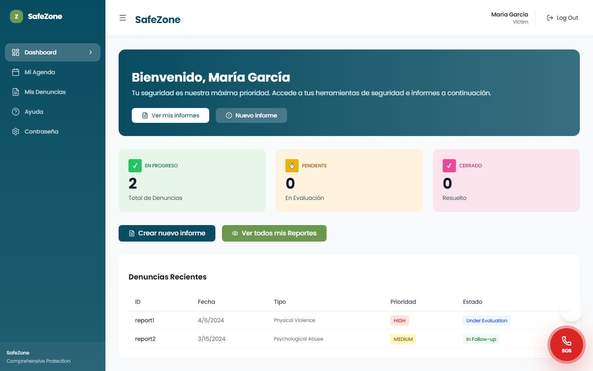
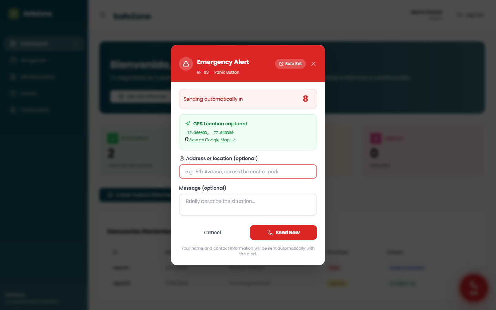
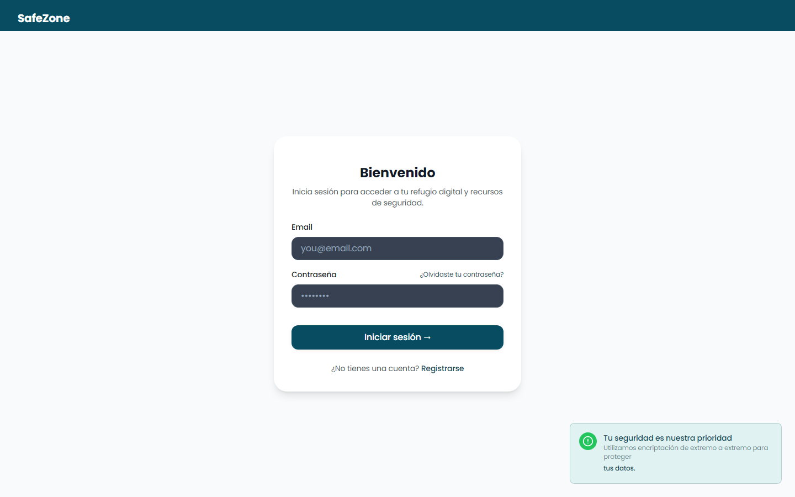
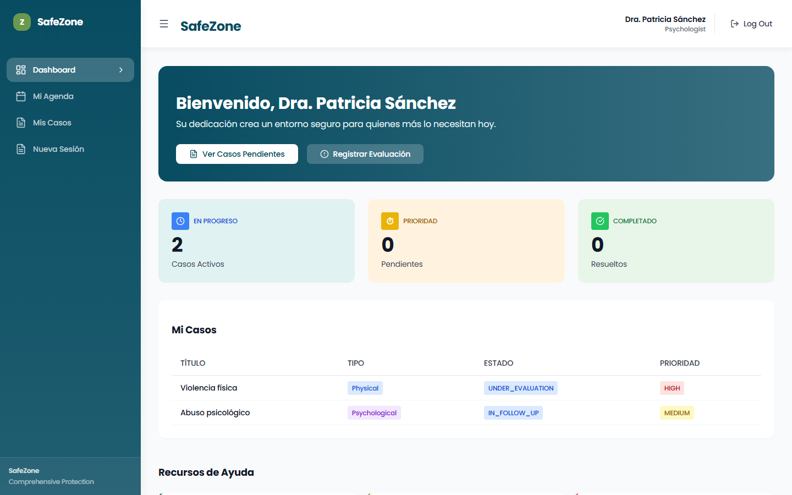

<p align="center">
  <a href="https://github.com/Nakusuo"></a>
</p>

# SafeZone

SafeZone es una plataforma para acompañar a personas que viven violencia. La idea es que en un mismo lugar puedan **pedir ayuda al instante**, **hacer una denuncia** y **hablar con profesionales** (psicólogos y defensores legales) que siguen su caso.

La hice como proyecto de la universidad (Ingeniería de Software) y es la parte del frontend. El backend va aparte, en Spring Boot.

<p align="center">
  
</p>

## Lo más importante: el botón de pánico

La persona tiene siempre a mano un botón **SOS** flotante. Al tocarlo, la app toma su ubicación por GPS y, si no la cancela, envía la alerta sola después de 10 segundos. Si el GPS está bloqueado, puede escribir la dirección a mano. También hay un botón de **salida segura** para cerrar todo rápido si alguien está mirando.

<p align="center">
  
</p>

Del otro lado, los profesionales ven las alertas activas en un panel y las marcan como atendidas o resueltas.

## Un panel para cada persona

Cada rol entra a una vista distinta, pensada para lo que necesita hacer:

- **Víctima**: sus denuncias, su agenda, el botón de pánico y recursos de ayuda.
- **Psicólogo/a**: sus casos activos, sesiones y evaluaciones.
- **Defensor/a legal**: casos y audiencias.
- **Administración**: triaje y asignación de casos a profesionales.

| Inicio de sesión | Panel de psicóloga |
|---|---|
|  |  |

## Con qué está hecho

React 18 + TypeScript, Vite, Tailwind CSS, React Router, Axios e íconos de Lucide. Tiene Capacitor configurado para empaquetarlo como app de Android.

El código está organizado por funcionalidades (`src/features/victim`, `psychologist`, `defender`, `admin`, `auth`), así cada rol tiene sus páginas, componentes y servicios juntos.

## Probarlo sin backend

No necesitas levantar el backend para verlo: con el **modo mock** la app usa datos de ejemplo guardados en el navegador.

```bash
npm install
# en el archivo .env cambia VITE_USE_MOCK a true
npm run dev            # http://localhost:5173
```

Cuentas de prueba (solo existen en el modo mock):

| Rol | Email | Contraseña |
|-----|-------|-----------|
| Administrador | admin@example.com | admin123 |
| Víctima | maria@example.com | password123 |
| Psicóloga | patricia@example.com | password123 |
| Defensor legal | carlos@example.com | password123 |

Para conectarlo al backend real, deja `VITE_USE_MOCK=false` y apunta `VITE_API_URL` a tu API (por defecto `http://localhost:8080/api`).

<details>
<summary>Endpoints del botón de pánico (RF-03)</summary>

| Método | Endpoint | Acción |
|---|---|---|
| `POST` | `/api/emergency/alerts` | Crea una alerta (GPS o dirección manual) |
| `GET` | `/api/emergency/alerts?status=ACTIVE` | Lista las alertas activas |
| `PATCH` | `/api/emergency/alerts/{id}/attend` | Un profesional atiende la alerta |
| `PATCH` | `/api/emergency/alerts/{id}/resolve` | Cierra la alerta |

</details>

<details>
<summary>Otros comandos</summary>

```bash
npm run build      # build de producción
npm run preview    # ver el build
npm run lint       # ESLint
```

</details>
